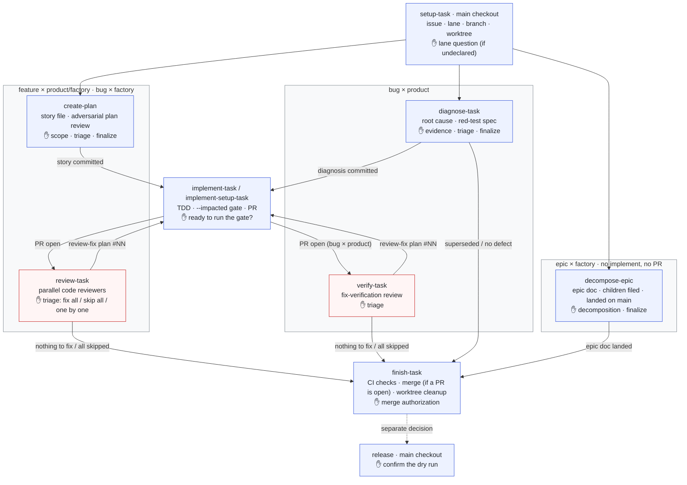

# QS-417 — Mermaid diagram of today's static-agent pipeline in overview.md

**Issue**: [#417](https://github.com/tmenguy/quiet-solar/issues/417) ·
**Lane of this task**: feature-factory (`target:factory`) — docs + one pin test

Status: planned (story v4, after review rounds 1 and 2). The maintainer confirmed:
- no SVG;
- ✋ touchpoints inline in each phase node, with no separate Maintainer
  node;
- a small pin test;
- no "frozen" wording, because the pipeline is still in daily use.

The maintainer delegated the triage of the automated review rounds and
asked not to review anything himself until finish-task. The automated
review rounds (plan and code) still run as normal.

## Problem

[`docs/workflow/overview.md`](../workflow/overview.md) "The six phases"
shows the pipeline only as a one-line text sketch
(`setup-task → create-plan → implement-task → review-task → finish-task → release`).
That sketch has no lane variants, no review ⇄ implement fix loop, and no
maintainer touchpoints. The bug × product and epic × factory lanes are
described only in prose underneath it. Since QS-369, Mermaid is the source
of truth for every diagram, and `overview.md` has none.

## Goal

One Mermaid flowchart under "The six phases", placed right after the
existing text sketch, showing:

1. the phases: setup-task → create-plan / diagnose-task → implement →
   review-task / verify-task ⇄ implement (review-fix plan `#NN`) →
   finish-task → release (a separate decision);
2. the maintainer's ✋ touchpoint in each phase;
3. the lane variants:
   - bug × product: diagnose → fix → verify, plus the diagnose → finish
     exit for superseded (iceberg) / no defect;
   - epic × factory: decompose-epic (epic doc landed on `main`) → finish,
     with no implement phase and no PR.

## Design

### Placement and lead-in

In `docs/workflow/overview.md`, section `## The six phases`, keep the
`text` sketch exactly as it is. Right after its closing fence, add this
lead-in paragraph, word for word (as shipped, after review fixes #01
and #02):

> The sketch above is the default path. The diagram below is the full
> picture: the lane variants, the review ⇄ implement fix loop, and, marked
> ✋, where the maintainer decides in each phase. Red-outlined boxes
> (review-task, verify-task) are the review phases that can send a fix plan
> back to implement; the dashed arrow is a separate decision.

Then add the ```` ```mermaid ```` block. Leave the lane paragraphs, the
phase table and every other section unchanged. Add no new H2 heading, so
the H2 order pinned by `tests/qs/docs/test_overview_structure.py` stays
the same.

### The diagram

The block below is the only source. It replaces the maintainer's local
draft
(`~/Desktop/qs-agentic-workflow-slides/claude-design-brief/diagrams/mermaid/old-01-todays-pipeline.mmd`,
not in the repo; the implementer does not need it). It differs from that
draft in four ways:

- each lane gets its own `subgraph`;
- the fix-loop edges are on both review-task and verify-task;
- the diagnose → finish exit is drawn;
- each ✋ is a line inside its node, instead of a Maintainer node with
  dashed edges.

Node labels stay short (phase · where it runs · output · ✋). They leave
out reviewer counts and inner state machines, which belong to
`phase-protocols.md` and `adversarial-review.md` and would drift.



**Fixed:**
- the node set: the 9 node ids above, each declared as `id["..."]` on its
  own line;
- the edge set (the 14 edges above), with their labels and their style
  (solid or dashed);
- the three subgraphs and their members;
- in each node label: the phase name(s) and the ✋ line.

**Free, for layout:**
- the rest of each node label's wording;
- the direction (`TB` / `LR`);
- the order of declarations;
- invisible `~~~` links.

Parse safety (checked in round 2):
- every label is quoted;
- `#NN` is safe because Mermaid only turns `#\w+;` into an entity, and the
  block contains no `;`;
- `style` on a subgraph id is supported on GitHub.

Facts checked against the templates during review round 1:
- setup asks the lane question only when the lane is not declared
  (`qs-setup-task.md.j2` step 1b);
- implement asks "Ready to run the quality gate?";
- finish asks for merge authorization, and it only cleans up when no PR
  is left to merge (no PR, a PR already merged, or a PR closed by the
  diagnose exit);
- release asks to confirm the dry run;
- diagnose has three exits: fix, superseded (iceberg) and no defect;
- both review-task and verify-task go back to implement through a
  review-fix plan, in the same session or a new one;
- epic × product is not codified yet and stops at setup (#339), so it is
  not drawn.

### No SVG

The block carries **no** `%% @` hints and no `@out`. `mermaid_svg.py`
skips it, because `outputs_from_text` renders only blocks that have an
`@out` hint, so no SVG is committed and
`test_every_svg_in_docs_is_up_to_date` is unaffected. If the layout turns
out hard to read, the implementer does **not** add an SVG (the test does
not forbid one, so a later maintainer decision stays open). They tweak
within the "Free" list above, and if the layout is still poor, they
mention it in the PR body for the maintainer to judge at finish-task.

### Pin test

> Superseded in part by review fixes #01 and #02: the test now parses
> every line of the block and pins edges with their style and label,
> subgraph membership and titles, the phase names in each node, and ✋ on
> its own line. See `QS-417.story_review_fix_#01.md` and `#02`.

The new test goes in `tests/qs/docs/test_overview_structure.py`, under a
`# QS-417 —` comment banner (following the QS-311 banner pattern in that
file):

- `PIPELINE_DIAGRAM_PHASES = ("setup-task", "create-plan",
  "diagnose-task", "decompose-epic", "implement-task",
  "implement-setup-task", "review-task", "verify-task", "finish-task",
  "release")`.
- `_six_phases_section() -> str`: `body = OVERVIEW.read_text(encoding="utf-8")`
  and `heading = "## The six phases"`. Assert `heading in body`, with a
  message. Then `start = body.index(heading) + len(heading)` and
  `m = re.search(r"^## ", body[start:], re.M)`. Return
  `body[start:start + m.start()]` if `m` is found, otherwise
  `body[start:]`. This is the same approach as `_gui_section_body()`.
- `PIPELINE_DIAGRAM_NODES = {"setup", "plan", "diag", "dec", "impl",
  "rev", "ver", "fin", "rel"}`, and `PIPELINE_DIAGRAM_EDGES`: the set of
  the 14 `(src, dst)` pairs from Design.
- `test_six_phases_section_has_pipeline_diagram() -> None`:
  - Collect blocks with
    `re.findall(r"^```mermaid\n(.*?)^```", section, re.S | re.M)`.
  - Assert `len(blocks) == 1`, with a message. This assertion is the red
    failure, not an exception.
  - Assert that the block starts with `flowchart` after `lstrip()`.
  - Placement:
    - assert `"```text" in section`;
    - assert `section.index("```text") < section.index("```mermaid")`;
    - assert that `"The sketch above is the default path."` appears
      between those two indexes.

    Each assertion has a message.
  - For each phase in `PIPELINE_DIAGRAM_PHASES`, assert that
    `re.search(rf"(?<![\w-]){re.escape(phase)}(?![\w-])", block)` matches.
  - `nodes = dict(re.findall(r'^\s*(\w+)\["(.*?)"\]', block, re.M))`.
    Assert `set(nodes) == PIPELINE_DIAGRAM_NODES`, then assert that every
    label contains `"✋"`.
  - `edges = set(re.findall(r'^\s*(\w+)\s*-\.?->(?:\|"[^"]*"\|)?\s*(\w+)\s*$', block, re.M))`.
    Assert `edges == PIPELINE_DIAGRAM_EDGES`.
  - Keep the Python file ASCII except for the `"✋"` literal: no `×` or `·`
    in comments or strings (ruff RUF001/RUF003).

The test pins the diagram's placement, the lead-in, the phase names, the
node set, the ✋ touchpoints and the edge set. It does **not** detect a
phase that is added to the pipeline later, and it does not check label
wording beyond the phase names and ✋. Both stay a review responsibility.

## Acceptance criteria

1. **AC1** — `docs/workflow/overview.md` `## The six phases` holds exactly
   one ```` ```mermaid ```` `flowchart` block, placed after the existing
   `text` sketch and introduced by the lead-in paragraph in Design. The
   sketch, the lane paragraphs and the phase table are unchanged.
2. **AC2** — The block has nodes naming `setup-task`, `create-plan`,
   `diagnose-task`, `decompose-epic`, `implement-task`,
   `implement-setup-task`, `review-task`, `verify-task`, `finish-task` and
   `release`. Its edges are the set in Design, including:
   - review-task → implement and verify-task → implement, labelled
     "review-fix plan #NN";
   - finish → release as a dashed "separate decision" edge;
   - diagnose → finish (superseded / no defect);
   - decompose → finish.
3. **AC3** — Every phase node label has a `✋` touchpoint.
4. **AC4** — The bug × product and epic × factory phases sit in their own
   `subgraph`, named after the lane.
5. **AC5** — The block is valid Mermaid that renders on GitHub, with no
   `@out` and no SVG added. Implement runs the local parse check (step 3)
   when it can. The review phase orchestrator opens the PR's rendered
   `overview.md` on GitHub in a browser and checks it. The maintainer
   sees it again at finish-task.
6. **AC6** — `test_six_phases_section_has_pipeline_diagram` fails before
   the doc edit and passes after it.
   `python scripts/qs/quality_gate.py --impacted` and
   `python scripts/qs/quality_gate.py --quick tests/qs` are green.

## Task breakdown

1. **Red**: add the banner, constant, helper and test (Design → Pin test)
   to `tests/qs/docs/test_overview_structure.py`. Run
   `pytest tests/qs/docs/test_overview_structure.py::test_six_phases_section_has_pipeline_diagram -v`
   and confirm it fails on the `len(blocks) == 1` assertion.
2. **Green**: insert the lead-in paragraph and the Mermaid block (Design)
   into `docs/workflow/overview.md` right after the `text` sketch's
   closing fence. Re-run the same node id and confirm it passes.
3. **Local parse check**: copy the block to a scratch `.mmd` file, outside
   the repo, and run
   `npx -y @mermaid-js/mermaid-cli -i <scratch>.mmd -o <scratch>.svg`.
   It must exit 0. If `npx` or the Chromium download is not available,
   note "Mermaid not parsed locally" in the PR body and go on. GitHub
   rendering is checked in the review phase (AC5).
4. **Gate**: run `python scripts/qs/quality_gate.py --impacted`, then
   `python scripts/qs/quality_gate.py --quick tests/qs`. If a docs-policy
   test fails, stop and report; do not work around it. Use **one** commit
   for the test and the doc together, made after the gate is green.

Doc-OK: `check_doc_drift.py --paths docs/workflow/overview.md
tests/qs/docs/test_overview_structure.py` reported no `docs/agents/`
document. `overview.md` is itself the doc being updated.
`phase-protocols.md`, the lane docs and `CLAUDE.md` are unaffected,
because the diagram describes existing behaviour.

## Out of scope

- Renaming the "The six phases" heading.
- A diagram of the new Control Plane pipeline (epic #369, child 16).
- Diagrams in `phase-protocols.md` or the lane docs.
- The rare verify → diagnose re-entry (the fix misses the cause), the
  epic × product stop at setup, and reviewer rosters. They are left out on
  purpose to keep the diagram readable.

## Risks

- Mermaid's automatic layout may cross edges, because three lane boxes
  and two loop-backs share one diagram. The implementer adjusts within
  the "Free" list, and as a last resort flags it in the PR body. No SVG is
  added without the maintainer's approval.
- Labels can drift from the protocols. They are kept to stable facts
  (phase names, outputs, ✋ decisions) to reduce that risk.

## Adversarial Review Notes

### Round 1 (story v2): 4 global reviewers. Triage delegated by the maintainer.

Every finding below except the two rejected ones is folded into v3 and
marked `resolved`.

| id | source | finding | state |
|---|---|---|---|
| R1-1 | critic C1 | pin-test "fails when a phase is added" claim was false | resolved: claim removed, limit stated |
| R1-2 | critic C2 / dev-proxy R2 / planner Q3 | SVG fallback overrode the maintainer's no-SVG decision | resolved: no SVG, flag in PR body |
| R1-3 | dev-proxy C1 / planner C1 | raw `pytest <file>` breaks the `::` rule | resolved: node id form |
| R1-4 | planner C2 / critic K1 | draft `.mmd` not in repo | resolved: inline block is the only source |
| R1-5 | critic R1 / dev-proxy I1-I3 / planner I1-I2 | pin test weak (substring, ✋ once, no `implement-setup-task`, no placement, crash vs assertion) | resolved: concrete spec |
| R1-6 | critic R2 / K2 / scope SG-7 | frozen structure vs layout tweaks; subgraph wraps an outside path | resolved: Fixed / Free lists |
| R1-7 | planner R1 / critic K3 | "new session" on the fix edge is wrong; labels inconsistent | resolved: same label on both edges |
| R1-8 | planner R2 | "other lanes" included epic × product | resolved: subgraph renamed; epic × product out of scope |
| R1-9 | scope SG-1 / critic I1 / planner I3 | reviewer counts and state machines drift | resolved: trimmed labels |
| R1-10 | critic I2 / scope SG-2 / dev-proxy I4 / planner I4 | unused `classDef lane` | resolved: `style` on subgraphs |
| R1-11 | critic I3 / I4, K4 / scope SG-4 / planner Q1 | lead-in not written; sketch vs diagram role | resolved: exact paragraph |
| R1-12 | dev-proxy I5 / planner I5 | finish label wrong for no-PR paths; verify "clean" understated | resolved |
| R1-13 | scope SG-3 / critic K6 / dev-proxy R1 | npx render check vague; who checks GitHub | resolved: optional local check, review checks GitHub |
| R1-14 | planner I6 | doc-drift run omitted the test path | resolved |
| R1-15 | dev-proxy I6, K5 | regression stop rule; commit layout | resolved |
| R1-16 | planner Q2 | verify → diagnose re-entry | resolved: out of scope |
| R1-17 | scope SG-5 | "exactly one" block may break a future diagram | rejected: child 16 goes in its own doc; one block is right for this section |
| R1-18 | scope SG-6 | iceberg exit beyond the issue | rejected: real lane behaviour, cheap, kept |
| R1-19 | scope SG-8 | AC6 mentions the SVG test | resolved: reworded |

### Round 2 (story v3): 4 global reviewers + delta-auditor. Triage delegated by the maintainer.

The delta-auditor confirmed that every accepted R1 finding is resolved,
except R1-12, which the v3 edit over-corrected (R2-1). The concrete-planner
ran the pin-test regexes on the block and checked GitHub parse safety: no
issue. In v4 the orchestrator re-ran the final regexes on the block: 9
nodes, 14 edges, all 10 phase names found, `setup-task` not matched
inside `implement-setup-task`.

| id | source | finding | state |
|---|---|---|---|
| R2-1 | delta critical / planner I3 | `fin` label read backwards ("cleanup only when there is no PR") | resolved: "merge (if a PR is open) · worktree cleanup" |
| R2-2 | critic P2-1 / dev-proxy I1 / planner I1 | ✋ check passed on an empty node list | resolved: node-id set asserted |
| R2-3 | critic P2-2 / scope SG2-2 | edge set "Fixed" but unpinned | resolved: edge set asserted |
| R2-4 | critic P2-3 | AC5 had no reliable verifier | resolved: local parse check is mandatory when available, PR-body note otherwise, review orchestrator checks GitHub in a browser |
| R2-5 | critic P2-4 | both "PR open" edges looked alike | resolved: "(bug × product)" on impl → ver |
| R2-6 | critic P2-5 | dashed edges meant two things; no legend | resolved: diagnose exit solid; legend sentence in lead-in |
| R2-7 | critic P2-6 / dev-proxy Q2 | lead-in unpinned | resolved: asserted between fences |
| R2-8 | critic P2-7, P2-10 / scope SG2-2 / planner I2 | Free list contradicted fixed labels; subgraph item ambiguous; per-subgraph direction ineffective | resolved: Free list narrowed |
| R2-9 | critic P2-8 | iceberg vs superseded naming | resolved: "superseded (iceberg)" |
| R2-10 | critic P2-9 | "no fix to apply" vs "skip all" | resolved: "nothing to fix / all skipped" |
| R2-11 | critic P2-11 | `#NN`, `--impacted` parse risk | resolved: checked (no `;` in the block); local parse step |
| R2-12 | dev-proxy I2-I4 / planner K1-K2 | encoding, `-> None`, `re.escape`, ASCII, assert-before-index, section start | resolved |
| R2-13 | scope SG2-1 | `@out` assertion pinned a decision the issue leaves open | resolved: assertion dropped |
| R2-14 | scope SG2-3 | `implement-setup-task` beyond the issue's list | rejected: it is the factory variant of the implement phase; this very task uses it |
| R2-15 | scope SG2-4 | Goal "land" step vs one node | resolved: Goal reworded |
| R2-16 | delta clarify | "no further review" vs round 2 | resolved: status says maintainer review only |
| R2-17 | delta improve | brittle `mermaid_svg.py:581` citation | resolved: cites `outputs_from_text` |

**Shipped state at FINALIZE:** 0 open critical findings. The v4 edits
(test-spec tightening, label fixes) were not re-reviewed in a round 3.
Under the maintainer's delegation the orchestrator judged them mechanical
fixes of round-2 findings and checked them directly against the regexes
above.
